Heyo, I am Chaosyr, or I should say we are Chaosyr. For one we are Plural see https://morethanone.info/ for some info on the subject, but the gist of it is there is essentially more than one of me within my mind which go by different names, pronouns, identities etc. We do have ability to communicate with one another don't worry about things going out to the wrong one of us.

So I should probably introduce to you, the reader of this page what I do. I am the Community Manager over at [Fanscryption](https://discord.gg/wjQh9uSdpk) alongside LeshyIRL who owns the server. But that’s not all I run I also run [The Inscryption TCG Community](https://discord.gg/hPucz8xqng) which runs [The Inscryption PVP Wiki](https://www.notion.so/70261252cdb34b65a8658446d59bbd1e?pvs=21). I’m also a Active Modder over in [Inscryption Modding](https://discord.gg/ZQPvfKEpwM), I’ve been modding since ~2021, in fact Inscryption is what drove me to learn C#. Though you may catch me in some other game community’s as well! I am a Member of HYSMP; A Hytale Content Creator SMP as of ~1/6/2026, I also help behind the scenes for the games [Modding Community](https://discord.gg/4uDmafZQK9), mainly on the [Thunderstore](https://thunderstore.io/c/hytale/) side of things.

Moving back to the Initial subject, the above is our Vessel members and charts, the icons should roughly align with those within our status on Discord. Each icon associates with a Name and Pronouns, two of them represent combinations thus follow what's written in the pronouns spot to find the right ones. It should be pretty easy to follow once you know the code. Let’s shift gears and actually tell you about us on a bit more of a personal level. I am Bisexual/Biromantic (more gay leaning), I am also Polyamorous and a Femboy in real life.

Outside of Modding what else do I do? Well I’m a Youtuber and Twitch streamer for one, I won’t mention every single channel but two of the main ones are [Thincreator3483](https://www.youtube.com/channel/UCIZi4ckwI6JFp-4WkvrOhPQ), [The Stoat Lord](https://www.twitch.tv/the_stoat_lord), and [Chaosyr](https://www.youtube.com/@Chaosyr). I also make software which you can find over on my [GitHub](https://github.com/Chaosyr), and you can see dev streams related to it over on Chaosyr. I also founded [Cecil Libraries](https://github.com/Cecil-Libraries), a library and API development organization centered around C# and making things do as much as possible while remaining simple to use. Some other communities I run are [Pridetale](https://discord.gg/fyJMU9QTp5), [Chaosyr’s Vessel](https://discord.gg/XF4QVjy5aj), [Stoat Games](https://discord.gg/mRpWacaVu2), [Act 2; The Reimagining](https://discord.com/invite/VbKVNFbVEj), [SaxbyMod Support Discord](https://discord.gg/8yDjSXzvgu). There’s also a ton more but I don’t want to keep Historians waiting to long and im also done yapping for now, so we’ll end this here ^^

